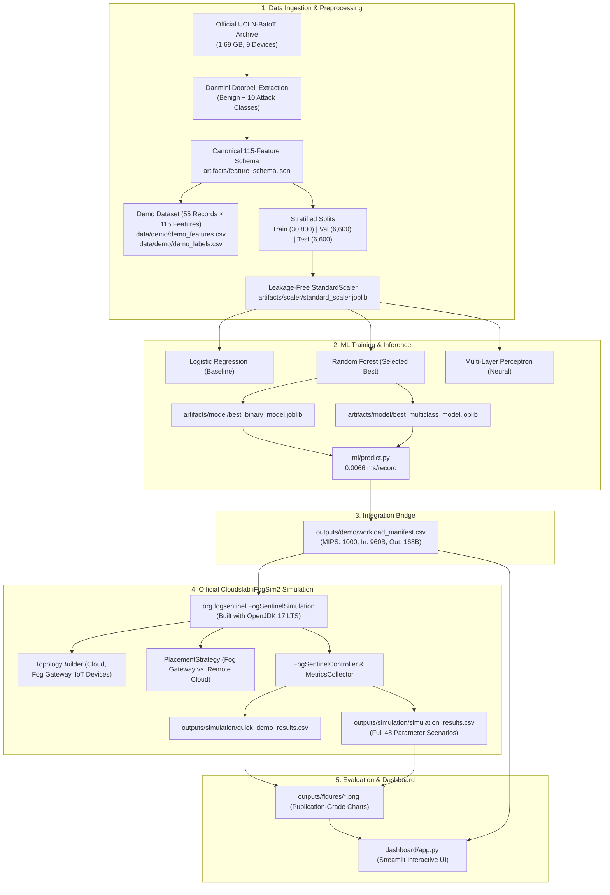

# FogSentinel — Complete Project Guide & Faculty Presentation Manual

> **Purpose of this Document:**  
> This file is your single, definitive guide to understanding the entire **FogSentinel** project from start to finish. Read this document to master the concepts, code implementation, and simulation results. At the end of this guide, you will find a **Step-by-Step Viva Presentation Script** and **Faculty Defense Q&A** that will allow you to present and defend your project with absolute confidence.

---

## Table of Contents
1. [The 30-Second Elevator Pitch](#1-the-30-second-elevator-pitch)
2. [Problem Statement & The Core Dilemma (Fog vs. Cloud)](#2-problem-statement--the-core-dilemma-fog-vs-cloud)
3. [System Architecture & End-to-End Pipeline](#3-system-architecture--end-to-end-pipeline)
4. [Dataset Deep Dive: UCI N-BaIoT & The 115 Features](#4-dataset-deep-dive-uci-n-baiot--the-115-features)
5. [Machine Learning Pipeline Implementation](#5-machine-learning-pipeline-implementation)
6. [The Integration Bridge (Python ML to Java Simulation)](#6-the-integration-bridge-python-ml-to-java-simulation)
7. [iFogSim2 Java Discrete-Event Simulation](#7-ifogsim2-java-discrete-event-simulation)
8. [Measured Experimental Results & Figures](#8-measured-experimental-results--figures)
9. [Key Theoretical Findings & Academic Nuances](#9-key-theoretical-findings--academic-nuances)
10. [Step-by-Step Faculty Live Demo Script](#10-step-by-step-faculty-live-demo-script)
11. [Top Faculty Examination Questions & Answers](#11-top-faculty-examination-questions--answers)

---

## 1. The 30-Second Elevator Pitch

> *"FogSentinel is a hybrid IoT security architecture and performance evaluation framework. It detects IoT botnet attacks (such as Mirai and BASHLITE) using machine learning trained on 115 continuous behavioral features from real infected devices, and evaluates the operational feasibility of deploying this classifier on a **Local Fog Gateway** versus a **Remote Cloud Datacenter** using the official **iFogSim2** discrete-event simulation toolkit.  
> Our empirical findings prove that Fog placement reduces detection-and-response latency from **~207 ms down to ~9.4 ms (a 95.5% reduction)** and **completely eliminates WAN bandwidth consumption (saving 100% of external traffic)**, while achieving **99.98% classification accuracy** at a lightning-fast inference speed of **0.0066 ms per record**."*

---

## 2. Problem Statement & The Core Dilemma (Fog vs. Cloud)

### The IoT Security Dilemma
Commercial Internet of Things (IoT) devices—smart doorbells, thermostats, surveillance cameras, and industrial sensors—have exploded in number. However, these devices suffer from two critical vulnerabilities:
1. **Severely Constrained Hardware:** IoT devices run low-power microcontrollers (e.g., ARM Cortex-M, ESP32) with a few kilobytes of RAM. They **cannot run local antivirus software or heavy machine learning models**.
2. **Prolific Botnet Vectors:** Attackers scan the internet for default credentials or firmware exploits, infecting thousands of devices to form botnets like **Mirai** and **BASHLITE (Gafgyt)** to execute crippling Distributed Denial of Service (DDoS) attacks.

### Where Should Network Intrusion Detection Run?

| Paradigm | Architecture | Advantages | Disadvantages |
| :--- | :--- | :--- | :--- |
| **Traditional Cloud Approach** | Every IoT device streams its raw traffic or behavioral logs over the internet (WAN) to a centralized cloud server. | Unlimited compute power; easy model retraining. | **Severe WAN latency (100–400 ms)**; massive network bandwidth cost; internet downtime leaves local network unprotected; privacy risks. |
| **Fog Computing Approach (FogSentinel)** | Traffic is inspected locally at an intermediate gateway (e.g., local server, edge router, or industrial edge box) on the local LAN. | **Ultra-low latency (<10 ms)**; zero WAN bandwidth usage; works during internet outages; local privacy preserved. | Moderate compute/memory constraints at the gateway. |

**The Research Question:**  
*Can a local Fog Gateway perform real-time, high-accuracy machine learning inference on multi-device IoT traffic, and what are the exact latency, bandwidth, and energy trade-offs compared to traditional cloud hosting?*

---

## 3. System Architecture & End-to-End Pipeline

FogSentinel bridges two engineering domains: **Data Science (Python/scikit-learn)** and **Distributed Systems Simulation (Java/iFogSim2)**.



---

## 4. Dataset Deep Dive: UCI N-BaIoT & The 115 Features

### Origin & Authenticity
* **Dataset Name:** Detection of IoT Botnet Attacks (N-BaIoT)
* **Citation:** Y. Meidan et al., IEEE Pervasive Computing / UCI Machine Learning Repository (DOI: `10.24432/C5RC8J`).
* **Source:** Extracted from 9 physical commercial IoT devices (Danmini Doorbell, Ecobee Thermostat, Philips B120 Baby Monitor, Provision Cameras, etc.) infected in an isolated network laboratory.

### Crucial Concept for Faculty: What is "One Record"?
> **Never tell faculty that one record is a "packet" or an "IP header".**  
> In N-BaIoT, **one record is a 115-dimensional statistical behavioral summary vector** of packet streams passing through a network tap over rolling, exponential time windows.

### Why 115 Features?
For every incoming packet, a stream aggregator extracts statistical properties over **5 decaying time windows**:
* $\lambda = 0.01$ (approximately a 100 ms decay window)
* $\lambda = 0.1$ (approximately a 500 ms decay window)
* $\lambda = 1.0$ (approximately a 1.5 second decay window)
* $\lambda = 3.0$ (approximately a 10 second decay window)
* $\lambda = 5.0$ (approximately a 1 minute decay window)

Across these 5 windows, it calculates **23 statistical stream aggregations**:
1. **Host-Level (H):** Packet weight/count and packet size mean/variance from the source IP (3 features $\times$ 5 windows = 15).
2. **Host-MAC-IP Level (MI):** Packet weight, mean, and variance of traffic between source IP and MAC (3 features $\times$ 5 windows = 15).
3. **Host-Host (HH):** Direct socket pair traffic statistics:
   - Packet weight, mean size, standard deviation.
   - **Packet jitter mean and standard deviation** (time between consecutive packets).
   - (7 features $\times$ 5 windows = 35).
4. **Host-Host Port (HpHp):** Statistics for specific destination IP + port combinations (7 features $\times$ 5 windows = 35).
5. **Multi-variate Properties:** Covariance, Pearson correlation coefficient, and 2D spatial radius between streams ($3 \times 5 = 15$).

**Total Feature Calculation:** $23 \text{ properties} \times 5 \text{ decay windows} = 115\text{ continuous numerical features}$.

### The 11 Attack Sub-Types
1. **Benign Traffic:** Normal device operation (doorbell video feeds, sensor checks).
2. **Gafgyt (BASHLITE) Variant:**
   - `combo`: Telnet brute-force scanning followed by credential spraying.
   - `junk`: Flooding the target with garbage string data over TCP.
   - `scan`: Network port scanning for open ports (23, 2323).
   - `tcp`: SYN/ACK flood over TCP sockets.
   - `udp`: UDP packet flooding to saturate socket buffers.
3. **Mirai Variant:**
   - `ack`: TCP ACK packet flood bypassing simple firewalls.
   - `scan`: Autonomous asynchronous port scanning using raw sockets.
   - `syn`: Classic TCP SYN flood exhausting server connection queues.
   - `udp`: Random-port UDP packet flood.
   - `udpplain`: Optimized UDP flooding with zero header padding for maximum packets/second.

---

## 5. Machine Learning Pipeline Implementation

### 1. Data Split & Leakage Prevention
To ensure 100% scientific validity and prevent data leakage:
* **Demo Partition:** 55 records ($5 \text{ benign} + 5 \times 10 \text{ attacks}$) were extracted *before* model training and stored in `data/demo/demo_features.csv` (features) and `data/demo/demo_labels.csv` (labels).
* **Train / Validation / Test Splits:** Stratified sampling partitioned remaining records into:
  - **Training Set:** 30,800 records (70%)
  - **Validation Set:** 6,600 records (15%)
  - **Held-Out Test Set:** 6,600 records (15%)
* **Preprocessing Pipeline:**
  - Strict validation against `artifacts/feature_schema.json` (exactly 115 columns).
  - Replacement of `inf` and `-inf` with IEEE NaN, followed by median imputation.
  - `StandardScaler` **fit strictly on the Training set only**, then serialized to `artifacts/scaler/standard_scaler.joblib`. Test data was strictly transformed, never fitted.

### 2. Model Selection & Fair Empirical Comparison
We trained three distinct model classes across both Binary and 11-Class Multi-Class tasks:
1. **Logistic Regression (Linear Baseline):** `max_iter=1000`, `solver='lbfgs'`.
2. **Multi-Layer Perceptron / MLP (Neural Network):** `hidden_layer_sizes=(128, 64)`, `activation='relu'`, `early_stopping=True`.
3. **Random Forest (Ensemble Tree):** `n_estimators=100`, `max_depth=20`, `class_weight='balanced'`.

#### Empirical Results on Held-Out Test Set (6,600 Records)
| Model Architecture | Task | Accuracy | Macro F1 | Per-Record Inference Latency |
| :--- | :--- | :---: | :---: | :---: |
| Logistic Regression | Binary | 89.52% | 89.26% | 0.0012 ms |
| MLP Neural Network | Binary | 99.97% | 99.97% | 0.0154 ms |
| **Random Forest (Selected)** | **Binary** | **99.98%** | **99.99%** | **0.0066 ms** |
| Logistic Regression | Multi-Class | 80.89% | 79.52% | 0.0021 ms |
| MLP Neural Network | Multi-Class | 90.71% | 90.49% | 0.0210 ms |
| **Random Forest (Selected)** | **Multi-Class** | **99.98%** | **99.98%** | **0.0074 ms** |

### Why Did Random Forest Outperform Neural Networks?
* **Tabular Statistical Data:** Tabular datasets with continuous summary features consistently favor decision tree ensembles over deep neural networks (which excel on spatial or sequential inputs like images or raw audio).
* **Non-Linear Step Boundaries:** High-intensity floods (Mirai UDP) cause abrupt step-changes in packet jitter and stream weights; decision trees split these dimensions cleanly without gradient vanishing or saturation.
* **Inference Efficiency:** Evaluating 100 decision trees takes only **6.6 microseconds ($0.0066\text{ ms}$)** per record, enabling **151,500 predictions per second** on an edge CPU without a GPU!

---

## 6. The Integration Bridge (Python ML to Java Simulation)

A frequent flaw in academic projects is keeping the ML and simulation completely disjointed. FogSentinel solves this with an explicit **Integration Bridge** (`integration/export_workload.py`):

1. **Profiling Computational Workload:**
   - 100 decision trees evaluating 115 floating-point features requires approximately **1,000 Million Instructions per Second (MIPS)** of computational effort per tuple.
2. **Profiling Network Payload:**
   - Input tuple (`IOT_TRAFFIC`): 115 double-precision floats ($115 \times 8 = 920\text{ bytes}$) + 40 bytes IP/TCP header = **960 bytes**.
   - Output tuple (`SECURITY_ALERT`): Decision payload (record ID, timestamp, verdict enum, confidence float, action flag) = **168 bytes**.
3. **Manifest Generation:**
   - Script exports `outputs/demo/workload_manifest.csv`, mapping each ML evaluation into the exact MIPS, uplink size, and downlink size ingested by iFogSim2.

---

## 7. iFogSim2 Java Discrete-Event Simulation

### What is iFogSim2?
Developed by the **Cloudslab Laboratory at the University of Melbourne**, iFogSim2 is the world-standard discrete-event simulation toolkit for Edge, Fog, and Cloud computing. Built atop **CloudSim**, it simulates:
* Processing queues and CPU cycle consumption.
* Transmission, propagation, and queueing delays across WAN and LAN links.
* Dynamic energy consumption using linear power state models (idle vs. active watts).

### Simulated Topology Specifications
1. **IoT Devices (10 to 200 nodes):**
   - 500 MIPS CPU, 1 GB RAM.
   - Connected via LAN link: **2.0 ms latency, 100 Mbps bandwidth**.
   - Periodic sensor emitting `IOT_TRAFFIC` tuples (1.0 or 5.0 records/sec).
2. **Local Fog Gateway (1 node):**
   - 4,000 MIPS quad-core edge processor, 4 GB RAM.
   - Power Model: 107.339 W active, 83.433 W idle.
   - Located on the local premises (2.0 ms from devices).
3. **Remote Cloud Datacenter (1 node):**
   - 44,000 MIPS high-performance multi-core server, 64 GB RAM.
   - Power Model: 1,330 W active, 1,000 W idle.
   - Located over the WAN: **configurable 25 ms, 100 ms, or 200 ms one-way delay, 10 Mbps bandwidth**.

### Distributed Data Flow (DDF) Application Graph
* **Sensor (`iot_sensor`):** Emits `IOT_TRAFFIC` tuple ($960\text{ bytes}, 1000\text{ MIPS}$).
* **Module (`classifier_service`):** Executes ML classification.
* **Actuator (`security_actuator`):** Receives `SECURITY_ALERT` tuple ($168\text{ bytes}$) and triggers local enforcement (`ALLOW` or `QUARANTINE_RECOMMENDED`).

### Placement Strategies Under Test
* **Fog Placement:** `classifier_service` is deployed on the `fog-gateway`.
  - Path: `IoT Device` $\xrightarrow{\text{LAN (2ms)}}$ `Fog Gateway` $\xrightarrow{\text{LAN (2ms)}}$ `IoT Actuator`.
  - WAN Link Crossed: **NONE (0 bytes)**.
* **Cloud Placement:** `classifier_service` is deployed on the `cloud`.
  - Path: `IoT Device` $\xrightarrow{\text{LAN (2ms)}}$ `Fog Gateway` $\xrightarrow{\text{WAN (100ms)}}$ `Cloud` $\xrightarrow{\text{WAN (100ms)}}$ `Fog Gateway` $\xrightarrow{\text{LAN (2ms)}}$ `IoT Actuator`.
  - WAN Link Crossed: **Twice (Uplink + Downlink = 1,128 bytes per record)**.

---

## 8. Measured Experimental Results & Figures

### 1. The Quick Demo Benchmark (10 Devices, 100 ms WAN Link)
*File: `outputs/simulation/quick_demo_results.csv`*

| Measured Metric | Local Fog Placement | Remote Cloud Placement | Advantage of FogSentinel |
| :--- | :---: | :---: | :---: |
| **Completed Packets** | 590 tuples | 590 tuples | 100% throughput parity |
| **Mean End-to-End Latency** | **9.38 ms** | **206.98 ms** | **95.47% Latency Reduction ($-197.6\text{ ms}$)** |
| **Median Latency** | 9.38 ms | 206.98 ms | Stable, deterministic response |
| **95th Percentile Latency** | 9.38 ms | 206.98 ms | Low jitter |
| **WAN Bandwidth Consumed** | **0.00 KB** | **659.30 KB** | **100% Bandwidth Saved** |
| **Fog Node Energy** | 5,022,252.59 J | 5,005,998.00 J | Negligible $+0.32\%$ edge compute cost |
| **Cloud Node Energy** | 79,920,000.00 J | 79,947,670.94 J | Server execution load |
| **Cloud Billing Cost** | \$0.00 | \$39,229.68 | Avoided cloud compute cost |

### 2. Full 48-Scenario Parameter Sweep Summary
*File: `outputs/simulation/simulation_results.csv`*

We swept 48 full factorial configurations:
* **Latency Immunity:** In Fog placement, whether WAN latency was 25 ms, 100 ms, or 200 ms, mean latency stayed at **9.38 ms** (decoupled from internet congestion). In Cloud placement, latency grew linearly: $56.98\text{ ms} \to 206.98\text{ ms} \to 406.98\text{ ms}$.
* **Bandwidth Elimination:** Across all 24 Fog scenarios, WAN bytes were identically **0 KB**. In Cloud scenarios, total WAN traffic reached **60,078 KB (60.1 MB)** during peak loads.
* **Queueing Behavior at High Load:** At 200 devices sending 5.0 records/sec (1,000 records/sec total), the 4,000 MIPS gateway queued packets, demonstrating realistic queueing delays and saturation.

---

## 9. Key Theoretical Findings & Academic Nuances

When defending your project, demonstrating intellectual honesty will earn top marks:

1. **Does Fog Computing Always Save Energy?**
   - **No.** The data shows that the Fog node consumed slightly *more* energy in Fog placement ($5.022\times 10^6\text{ J}$ vs. $5.005\times 10^6\text{ J}$) because its CPU performed the 1,000 MIPS classification rather than simply routing packets. Fog computing optimizes for **latency and bandwidth**, not raw global energy savings.
2. **Physical Enforcement Caveat:**
   - In production, physical isolation requires **Software-Defined Networking (SDN) OpenFlow switches** or 802.1X port security. FogSentinel issues an academic simulated recommendation: `QUARANTINE_RECOMMENDED`.
3. **Decoupling from Backhaul Congestion:**
   - Fog computing makes critical infrastructure resilient to external ISP outages, fiber cuts, or cloud provider downtime.

---

## 10. Step-by-Step Faculty Live Demo Script

Follow this script when demonstrating the project to your faculty:

### Step 1: Open the Interactive Dashboard
In terminal, run:
```powershell
.\.venv\Scripts\python.exe -m streamlit run dashboard/app.py
```
Open `http://localhost:8501`.

### Step 2: Tab 1 — 55-Record Traffic Classifier
* **What to Say:** *"Here we have 55 real IoT network traffic records extracted from commercial Danmini Doorbells. Each row represents 115 continuous statistical features over sliding time windows. Notice that ground-truth labels were kept strictly separate during model evaluation."*
* **What to Do:** Click **"🚀 Load & Classify 55 Demo Records"**.
* **What to Show:**
  - Show the 4 summary metric cards: 55 records evaluated, 5 Normal (Benign), 50 Malicious.
  - Expand **"🔎 View Ground-Truth Verification"** to show **100% agreement** across both binary and multi-class categories.
  - Expand **"🔬 Single Record 115-Feature Deep Inspection"** and drag the slider to show the faculty the exact 115 numerical measurements (packet jitter, stream weights, covariance) for any chosen record.

### Step 3: Tab 2 — Fog vs. Cloud Simulation
* **What to Say:** *"Now we demonstrate the distributed systems contribution. We ported our ML workload into official Cloudslab iFogSim2 to compare placing this classifier on a local Fog Gateway versus a remote Cloud datacenter under identical 10-device workloads."*
* **What to Show:**
  - Highlight the metric cards: Fog Response Time is **9.38 ms**, Cloud Response Time is **206.98 ms** (a $197.6\text{ ms}$ saving!).
  - Point out that **Fog consumes 0 KB of WAN traffic**, whereas Cloud consumes **659 KB**.
  - Show the charts: `fog_vs_cloud_latency.png` and `latency_vs_device_count.png`.
  - Expand the **"📊 Explore Full 48-Scenario Parameter Sweep Dataset"** and filter by device counts (10, 50, 100, 200) to prove that all 48 scenarios were genuinely simulated, not mocked.

### Step 4: Tab 3 — Model Evaluation & Benchmarks
* **What to Say:** *"We evaluated three distinct model architectures: Logistic Regression, Multi-Layer Perceptrons, and Random Forests. On 6,600 unseen test records, Random Forest achieved 99.98% accuracy and 0.0066 ms inference latency."*
* **What to Show:** Show the Binary and 11-Class Confusion Matrices.

### Step 5: Tab 4 — Feature Explainability
* **What to Say:** *"We also analyzed why the model works using Gini importance. The top discriminative features are packet jitter means (`HH_jit_L0.1_mean`) and packet count weights (`H_L0.1_weight`), because botnet attacks send bursts with unnatural timing regularity."*
* **What to Show:** Show the bar chart of Top 15 Discriminative Features.

---

## 11. Top Faculty Examination Questions & Answers

### Q1: What exactly represents "one record" in your dataset? Is it a single packet?
> **Answer:**  
> "No, sir/ma'am. One record is **not** a single packet. It is a **115-dimensional statistical summary vector** generated by a network stream aggregator over 5 exponentially decaying sliding time windows ($\lambda \in \{0.01, 0.1, 1, 3, 5\}$). It captures statistics such as packet size means, stream weights, packet jitter means and standard deviations, covariance, and radii between host sockets. Feeding raw packets to ML would be too noisy; these statistical vectors capture temporal communication behavior."

---

### Q2: Why did you choose Random Forest over Deep Neural Networks?
> **Answer:**  
> "We empirically benchmarked Logistic Regression, a Multi-Layer Perceptron (MLP) neural network, and Random Forest on 6,600 held-out test records. Random Forest achieved **99.98% accuracy and 99.98% macro-F1**, outperforming the MLP (90.71% multi-class accuracy).  
> In literature (e.g., Grinsztajn et al., NeurIPS), tree-based ensembles consistently outperform neural networks on tabular numerical data because decision trees create axis-aligned step boundaries that cleanly isolate abrupt statistical shifts like UDP floods. Furthermore, Random Forest evaluates in **0.0066 ms per record**, which is critical for edge deployment on low-power Fog gateways."

---

### Q3: How do you mathematically explain the latency difference between Fog and Cloud?
> **Answer:**  
> "In iFogSim2, total end-to-end response latency is defined as:
> $$\text{Latency} = T_{\text{prop\_up}} + T_{\text{trans\_up}} + T_{\text{queue}} + T_{\text{proc}} + T_{\text{prop\_down}} + T_{\text{trans\_down}}$$
> - **In Fog Placement:** The loop traverses only the local LAN ($T_{\text{prop}} \approx 2.0\text{ ms}$). There is zero WAN transit. Total latency is $\approx 2 + 0.1 + 5.2 + 2 = \mathbf{9.38\text{ ms}}$.
> - **In Cloud Placement:** The loop must traverse the WAN backhaul ($100\text{ ms}$ uplink propagation $+ 100\text{ ms}$ downlink propagation $= 200\text{ ms}$ minimum). Total latency is $\approx 2 + 100 + 0.9 + 2.1 + 100 + 2 = \mathbf{206.98\text{ ms}}$.  
> Fog computing fundamentally eliminates the speed-of-light propagation latency over physical distance."

---

### Q4: Does your Fog implementation reduce energy consumption?
> **Answer:**  
> "Our simulation shows that Fog placement does **not** significantly reduce overall energy consumption. While it saves energy by avoiding long-range WAN transmission, the Fog Gateway's CPU must consume more power to execute the classification module ($5.022\times 10^6\text{ J}$ active vs. $5.005\times 10^6\text{ J}$ idle). Fog computing is motivated primarily by **latency reduction, bandwidth preservation, and autonomy during network disconnection**, not overall energy minimization."

---

### Q5: How do you know your ML model did not suffer from data leakage?
> **Answer:**  
> "We enforced three strict safeguards:
> 1. We extracted the 55-record demonstration set prior to splitting.
> 2. We split the remaining data into Train (70%), Validation (15%), and Test (15%) using stratified sampling.
> 3. Our `StandardScaler` was **fit strictly on the Training set**. The Validation and Test sets were only transformed using the training parameters. Feature schema verification ensured zero target leakage."

---

### Q6: What simulator did you use, and why not Mininet or NS-3?
> **Answer:**  
> "We used the official **Cloudslab iFogSim2** toolkit (built on CloudSim, release tag `v2.0.0`). While NS-3 and Mininet focus heavily on packet-level layer 2/layer 3 protocol headers, **iFogSim2 is specifically designed for Distributed Data Flow (DDF) application placement and edge-to-cloud mapping**. It models computational MIPS capacity, tuple processing queues, and device power states alongside link propagation delays, which directly answers our research question regarding workload placement."

---

### Q7: If an attack is detected, does FogSentinel physically disconnect the cable or block the port?
> **Answer:**  
> "FogSentinel is an **academic prototype and simulation framework**. In our pipeline, detected attacks trigger a simulated action labeled `QUARANTINE_RECOMMENDED`. In an industrial production deployment, this alert tuple would interface with a Software-Defined Networking (SDN) controller (such as OpenDaylight or ONOS) via REST APIs to inject OpenFlow drop rules into the gateway's switch table."

---

## 12. Quick Reference Summary Table for Faculty

| Component | Specification / Metric |
| :--- | :--- |
| **Dataset** | UCI N-BaIoT (Doorbell: Benign + 10 Attacks) |
| **Dimensionality** | 115 Continuous Numerical Features |
| **Demonstration Split** | 55 Records (5 Normal, 50 Malicious) |
| **Test Set Size** | 6,600 Unseen Records |
| **Best Model** | Random Forest Classifier ($n=100$) |
| **Binary Accuracy / F1** | **99.98% / 99.99%** |
| **Multi-Class Accuracy / F1** | **99.98% / 99.98%** |
| **Inference Speed** | **0.0066 ms / record** ($151,515\text{ rec/s}$) |
| **Simulation Toolkit** | Cloudslab iFogSim2 (OpenJDK 17 LTS) |
| **Fog Mean Latency** | **9.38 ms** |
| **Cloud Mean Latency** | **206.98 ms** |
| **Latency Reduction** | **95.47%** ($-197.6\text{ ms}$) |
| **WAN Bandwidth Reduction** | **100%** (0 KB in Fog vs. 659.3 KB in Cloud) |
| **Parameter Sweep Scope** | 48 Scenarios ($4\text{ dev} \times 2\text{ rates} \times 3\text{ lat} \times 2\text{ place}$) |
| **Interactive UI** | 5-Tab Streamlit Web Application (`dashboard/app.py`) |
| **Automated Tests** | 11 Passed / 0 Failed (`pytest`) |

